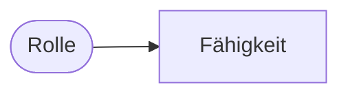

# {{title}}

> **Fachliche Architektur.** Was es tut und für wen, allgemein verständlich, ohne Technik; bildhafte Namen erlaubt. Für alle, zuerst den Nutzer. Was nicht als gesetzt markiert ist, ist *(Vorschlag der KI)*.

## Übersicht

*Ein Bild: Menschen, Teildienste oder Fähigkeiten und wie sie zusammenhängen.*

## Fähigkeiten

| Fähigkeit | Was sie leistet | für wen |
| --- | --- | --- |
| *bildhafter Name* | *ein Satz* | *Rolle* |

## Grundsätze

- *Was immer gelten soll, z. B. „Der Mensch entscheidet“.*

## Abläufe

1. *Ein typischer Ablauf, in Schritten aus Sicht des Nutzers.*

## Offen

- [ ] *Was noch zu klären ist.*

## Fassungen

| Version | Datum | Was sich ändert |
| --- | --- | --- |
| 0.1 | {{date:YYYY-MM-DD}} | Entwurf |
