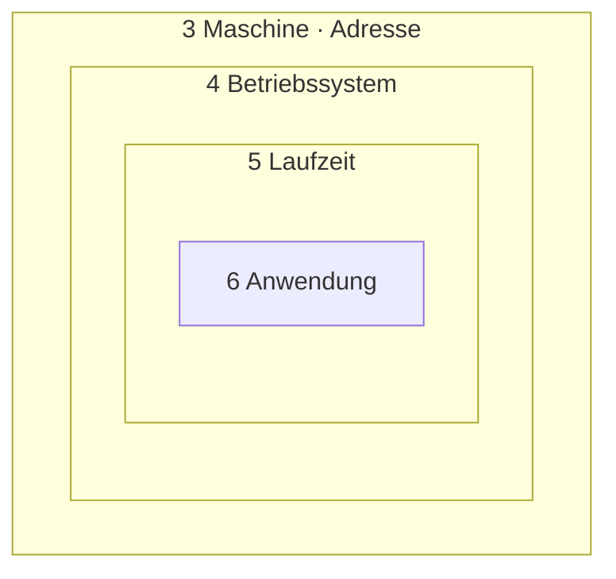

# {{title}}

> **Instanz** des Typs [[Typ]] für [[Dienst]]; heißt nach der Maschine oder einem Eigennamen. Was allgemein gilt, steht im Typ. Was nicht als gesetzt markiert ist, ist *(Vorschlag der KI)*.

*Ein bis zwei Sätze: was hier läuft, worauf, und mit wem es spricht.*

**Abgrenzung:** *Welche Schichten dieses Dokument abdeckt, und wo der Rest steht.*

## Auf einen Blick

*Bild von außen nach innen: Schichten mit Adressen und Zugriffswegen.*

## 6 Anwendung

| | |
| --- | --- |
| Version | *fest* |
| Öffnen | *Adresse, Port* |
| Daten | *Pfad* |

## 5 Laufzeit

## 4 Betriebssystem

## 3 Virtualisierung

*Nur die Schichten, die diese Komponente betreffen; leere Abschnitte löschen.*

## Ausbau

| Ausbau | Was er braucht | Folge |
| --- | --- | --- |

## Probe

| Teildienst | Probe |
| --- | --- |
| *Teildienst* | *Handlung mit sichtbarem Ergebnis* |

## Lücken

| Lücke | Folgeauftrag |
| --- | --- |
| *Was fehlt, damit sie voll ausgebaut ist* | *Auftrag* |

## Offen

- [ ] *Was noch zu klären ist.*

## Fassungen

| Version | Datum | Was sich ändert |
| --- | --- | --- |
| 0.1 | {{date:YYYY-MM-DD}} | Entwurf |
