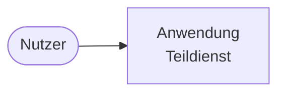

# {{title}}

> **Steckbrief.** Orientierung für alle Beteiligten, zuerst für den Nutzer, mit so wenig Technik wie möglich. Was nicht als gesetzt markiert ist, ist *(Vorschlag der KI)*.

**Nutzen.** *Ich … (ein Satz aus Sicht des Nutzers: was er kann, wo und womit).*

## Was du damit tun kannst

| Teildienst | Ich kann … |
| --- | --- |
| [[Teildienst]] | … *eine Sache tun.* |

Geplant: [[{{title}} - Entwicklungsplan]]

## Wie es zusammenhängt

*Ein fachliches Bild: wer was wo nutzt. Bildhafte Namen erlaubt, keine Adressen.*

| Anwendung | Öffnen | Einrichtung |
| --- | --- | --- |
| *Name* | *Wo man sie öffnet* | [[Komponente]] |

## Gut zu wissen

- *Was jeder Nutzer wissen sollte, z. B. wie lange etwas aufbewahrt wird.*
- *An wen man sich wendet, wenn etwas ausfällt.*

## Woraus er besteht

Der Dienst verantwortet alle ihm zugehörigen Komponenten bis zu einer Plattform.

| Komponente | Was sie tut | Steht auf |
| --- | --- | --- |
| [[Komponente]] | *ein Satz* | *Plattform oder Unterlage* |

Nutzt die Plattformen *…*.

## Absprünge

| Für | Wohin |
| --- | --- |
| Nutzer | *Teildienste* |
| Betreiber | *Komponenten, technische Architektur* |
| Entwicklung | [[{{title}} - Entwicklungsplan]], *Protokolle* |

## Offen

- [ ] *Was noch zu klären ist.*

## Fassungen

| Version | Datum | Was sich ändert |
| --- | --- | --- |
| 0.1 | {{date:YYYY-MM-DD}} | Entwurf |
